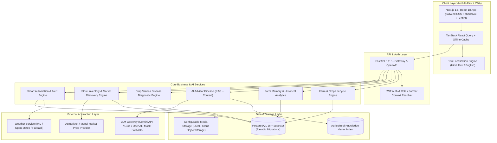

# KisanOS AI — System Architecture
**"From Soil to Sale" — One Farmer. One Farm. One Connected Platform.**

---

## 1. High-Level Architecture Overview

KisanOS AI is designed as a modular, decoupled full-stack platform built specifically for Indian farmers. It operates with a **Hindi-first, mobile-first, high-contrast, touch-optimized** interface backed by an asynchronous Python FastAPI service, a robust relational data model with vector search capabilities, and multi-modal AI advisor pipelines with deterministic offline-safe fallbacks.

---

## 2. Core Subsystems

### 2.1. Frontend (Next.js + TypeScript + Tailwind + shadcn/ui)
- **Framework**: Next.js (App Router / Pages Router with static export / SSR capability) with React Query for smart cache invalidation.
- **Farmer-First UX Design Tokens**:
  - Minimum touch target size: 48px.
  - Generous font scales with high legibility (`Noto Sans Devanagari` + `Inter`).
  - Native bilingual toggle (Hindi primary, English secondary) with instant reactive switching.
  - Vibrant agricultural emerald and amber accents, clear semantic status badges (Safe, Warning, Critical).
  - Interactive Leaflet.js maps with custom farm/store/market markers, distance calculation, and touch routing.
- **PWA & Offline Readiness**: Service worker manifests, cached farm details, resilient offline fallback cues.

### 2.2. Backend API (FastAPI + Pydantic v2 + SQLAlchemy 2.0)
- **Async REST API** with automatic OpenAPI/Swagger spec generation.
- **Layered Structure**:
  - `routers/`: Clean route definitions categorized by domain (`/api/auth`, `/api/farms`, `/api/advisor`, `/api/stores`, `/api/markets`, `/api/harvest`, `/api/notifications`, `/api/weather`).
  - `services/`: Encapsulated domain logic:
    - `farm_memory_service.py`: Computes farm historical averages, previous yield benchmarks, and contextual prompts.
    - `advisor_service.py`: Assembles Farm Context + Soil + Weather + RAG Knowledge chunks into structured prompts for the AI LLM layer.
    - `vision_service.py`: Multi-modal inspection engine with fallback disease classifier.
    - `automation_service.py`: Proactive rules engine for weather advisories, missed monitoring alerts, and market price spikes.
  - `models/`: SQLAlchemy 2.0 declarative database models.
  - `schemas/`: Pydantic models for strict input validation, serialization, and frontend contracts.

### 2.3. AI Farming Advisor & RAG Pipeline
- **Context Fusion Engine**:
  $$\text{Context} = \text{Farmer Question} + \text{Farm Profile} + \text{Soil/pH} + \text{Crop Stage} + \text{Farm Memory} + \text{Live Weather} + \text{RAG Chunks}$$
- **RAG Architecture**:
  - Curated crop dossiers for staples (Wheat, Rice, Potato, Tomato, Mustard, Sugarcane) with pest lifecycles, nutrient deficiencies, and approved organic & chemical remedies.
  - Embedding vector search powered by `pgvector` with cosine similarity retrieval.
  - Deterministic fallback provider ensuring 100% demo stability even when external LLM API rate-limits or keys are missing.
- **Structured JSON Output**: Every AI recommendation returns structured schemas with `summary`, `possible_issue`, `confidence`, `severity`, `general_guidance`, `recommended_products`, `nearby_stores`, `warnings`, and `sources`.

### 2.4. Vision & Disease Diagnostic Subsystem
- Ingests leaf, plant, or soil imagery.
- Normalizes and stores images via the configurable storage provider (`LocalStorageProvider` or S3/Cloud Storage).
- Evaluates visual symptoms via multimodal model or seeded botanical disease matching pattern (e.g. Early Blight, Late Blight, Yellow Rust, Leaf Curl Virus).
- Maps identified diseases directly to store inventory stock in the farmer's geographic cluster.

### 2.5. Store Inventory & Market Discovery Subsystem
- Geospatial distance calculation using Haversine algorithm.
- Store inventory tracking with real-time stock availability, MRP, and discounted farmer rates.
- Harvest Lot creation with quality grades (Grade A, B, C) and direct matching against local Mandis and APMC registered traders.

### 2.6. Smart Automation & Notification Engine
- Event-driven and scheduled rule evaluations:
  - *Rain Advisory*: If rain forecast > 60% within 48h -> "सिंचाई स्थगित करें (Postpone Irrigation)".
  - *Critical Disease Alert*: If observation severity is "critical" -> Dispatch notification to local cluster stores and emergency treatment steps.
  - *Market Opportunity Alert*: If Mandi crop price increases by > 5% -> Alert farmer to list pending harvest lots.
