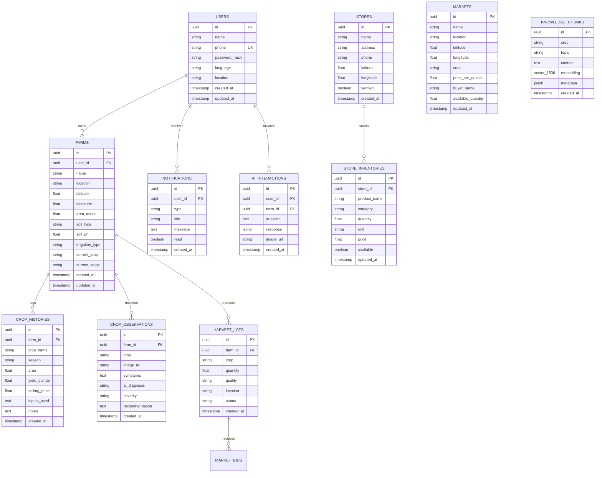

# KisanOS AI — Database Schema & Data Models
**PostgreSQL 16 + pgvector Data Architecture**

---

## 1. Relational Schema & Entity-Relationship Model

---

## 2. Table Specifications & Indexes

### 2.1. `users`
- Primary Key: `id` (UUID)
- Unique Index: `phone`
- Fields: `name`, `phone`, `password_hash`, `language` (default `'hi'`), `location`, `created_at`, `updated_at`.

### 2.2. `farms`
- Foreign Key: `user_id` references `users(id)` ON DELETE CASCADE
- Index: `user_id`, `(latitude, longitude)`

### 2.3. `crop_histories`
- Foreign Key: `farm_id` references `farms(id)` ON DELETE CASCADE
- Index: `farm_id`, `season`

### 2.4. `crop_observations`
- Foreign Key: `farm_id` references `farms(id)` ON DELETE CASCADE
- Index: `farm_id`, `severity`

### 2.5. `stores` & `store_inventories`
- Index on `stores`: `(latitude, longitude)` for spatial bounding box / Haversine filtering.
- Foreign Key: `store_id` references `stores(id)` ON DELETE CASCADE.
- Index on `store_inventories`: `(store_id, available)`, `product_name`.

### 2.6. `markets` & `harvest_lots`
- `harvest_lots.farm_id` references `farms(id)`.
- Status enum: `draft`, `ready_for_sale`, `bidding`, `sold`.
- `markets` indexed on `crop` and `location`.

### 2.7. `ai_interactions` & `notifications`
- Indexed on `user_id` and `created_at` DESC for rapid dashboard feeds.

### 2.8. `knowledge_chunks` (RAG Vector Index)
- Extension: `CREATE EXTENSION IF NOT EXISTS vector;`
- Column: `embedding vector(1536)` (or 384 for lightweight local models / Cosine similarity fallback)
- Index: HNSW index on `embedding vector_cosine_ops`.
